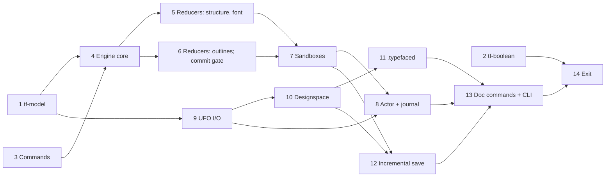

# Blueprint: Typefaced M1 — Headless engine

**Status: NOT STARTED.** The user reviews this plan and answers the gates (G1–G10) first.

**Objective.** Carry out milestone M1 of [docs/implementation-plan.md](../docs/implementation-plan.md) §14. When M1 is done, Typefaced has a headless engine:
- `tf-model`: the domain model of a font project, on persistent collections;
- `tf-engine`: one writer per document (actor), pure reducers, undo/redo history, transactions, sandboxes with a three-way merge, and a command journal;
- `tf-commands`: about 30 typed commands and their queries;
- `tf-io`: UFO 3 and designspace 5 folders and the `.typefaced` package;
- `tf-cli`: `typefaced info` and `typefaced convert`.

After that, M2 (build pipeline) can start.

| | |
|---|---|
| Created | 2026-10-14 |
| Scope | M1 only. M2 gets its own blueprint, created in Step 14 (rolling-wave planning). |
| Mode | Branch / PR / CI for every step. |
| Steps | 14 · critical path of 7 steps · up to 3 steps in parallel |
| Effort | About 23 working days solo; about 11.5 days on the critical path with parallel agents. §14 estimates 4 weeks. |
| Source documents | `docs/implementation-plan.md` §4 (layers), §5.1 (`tf-model`), §5.2 (boolean port), §5.10 (ports), §5.11 (`tf-commands`), §5.12 (`tf-engine`), §5.17 (`tf-io`), §5.18 (`tf-cli`), §7.2 (packed outlines), §9 (formats), §10.1 (errors), §10.4 (budgets), §10.5 (concurrency), §12 (quality), §14 (M1 row), §15 (R10, R16), Appendix A (commands), Appendix B (licences), Appendix C.1. ADRs 0002, 0003, 0004, 0005, 0008, 0010, 0017. [docs/milestones/m0-exit.md](../docs/milestones/m0-exit.md) (carry-over). |

## How to use this plan

- **One step per session and per pull request.** A fresh agent needs only four parts of this file: *Conventions*, *Invariants*, *User gates* and the step's own section.
- **Prompt for a new session:** `Execute Step N of plans/typefaced-m1-headless-engine.md, including commit, push and PR.`
- **Before you start:**
  - check that every step in *Depends on* is DONE in the status table;
  - check that every gate your step names has an answer in the *Change log*. If a gate has no answer, ask the user and stop;
  - update your local `main`.
- **When you finish:** set your row to `DONE (#PR)` inside your own PR, then stop.
- **Consent.**
  - A request to execute a step covers that step's local commits, the branch push, opening the PR, and the tools listed in its **Installs** row.
  - Merging, changing repository settings, posting on public trackers (for example an upstream issue), and anything marked **GATE** each need a separate, explicit yes from the user in chat.

## Status

| Step | Title | Depends on | Tier | Effort | Status |
|---|---|---|---|---|---|
| 1 | `tf-model`: domain model, glyph table, benchmarks | — | strongest | 2 d | DONE (#17) |
| 2 | `tf-boolean`: linesweeper adapter and regression corpus | — | default | 1.5 d | DONE (#19) |
| 3 | `tf-commands`: command catalog v1 and packed outlines | — | default | 1.5 d | DONE (#18) |
| 4 | `tf-engine` core: document, reducer dispatch, history | 1, 3 | strongest | 2 d | IN REVIEW (branch m1/04-engine-core) |
| 5 | Reducers: glyph structure, font data, queries | 4 | strongest | 1.5 d | TODO |
| 6 | Reducers: outlines, components, anchors; patches; commit gate | 4 | strongest | 2 d | TODO |
| 7 | Sandboxes: entity diff and three-way merge | 5, 6 | strongest | 2 d | TODO |
| 8 | Engine actor and command journal | 7, 9 | strongest | 1.5 d | TODO |
| 9 | `tf-io`: UFO read and write, corpus round trip | 1 | strongest | 2 d | TODO |
| 10 | `tf-io`: designspace and multi-master projects | 9 | strongest | 1.5 d | TODO |
| 11 | `tf-io`: the `.typefaced` package | 10 | default | 1.5 d | TODO |
| 12 | `tf-io`: incremental save and external-change guard | 7, 10 | default | 1.5 d | TODO |
| 13 | Document commands, repository port and `tf-cli` | 8, 11, 12 | default | 1.5 d | TODO |
| 14 | M1 exit review and handoff | all | strongest | 0.5 d | TODO |

**Tier:**
- `strongest`: run with the most capable model available. Used where the step is correctness-critical: the model, the engine core, history and sandbox semantics, the byte-stable UFO writer.
- `default`: the normal coding model.

## Dependency graph and parallel waves



| Wave | Steps (‖ = can run in parallel) | Files shared by the parallel steps |
|---|---|---|
| A | 1 ‖ 2 ‖ 3 | root `Cargo.toml`, `Cargo.lock`, root `CONTEXT.md`, `crates/CONTEXT.md`, status table; `crates/tf-geometry/Cargo.toml` (1 and 2); `.github/workflows/ci.yml` is edited by 1 only |
| B | 4 ‖ 9 (‖ 2 if still running) | the same root files. Step 9 may still run in wave C: then 9 and 6 both edit `.github/workflows/ci.yml` (different jobs) |
| C | 5 ‖ 6 ‖ 10 | `crates/tf-engine/CONTEXT.md`, `crates/tf-engine/src/CONTEXT.md`, `crates/tf-engine/Cargo.toml`, the one-line registration of each family generator in the history property test (5 and 6); `Cargo.lock`; status table. Error codes are all defined in Step 3, so 5 and 6 do not edit `tf-commands/src/error.rs` |
| D | 7 ‖ 11 | `Cargo.lock`, root `CONTEXT.md`, status table |
| E | 8 ‖ 12 | `crates/tf-io/src/lib.rs`, `crates/tf-io/Cargo.toml`, `crates/tf-io/src/CONTEXT.md`, `Cargo.lock`, status table |
| F | 13 | — |
| G | 14 | — |

- **Critical path:** 1 → 4 → 6 → 7 → 8 → 13 → 14, about 11.5 working days.
- Step 2 is off the critical path. It only has to be DONE before Step 14.
- Conflicts in shared files are resolved with the *merge protocol* below.

## Carry-over from M0

The M0 exit report ([m0-exit.md](../docs/milestones/m0-exit.md), *Carry-over items for M1*) asks the first M1 steps to take these items.

| Carry-over item | Step | Note |
|---|---|---|
| `tf-model`: `GlyphTable` on `imbl::Vector` with tombstones | 1 | Wave A |
| Regression benchmark: 50 µs single edit in the middle of a 30,000-glyph table; re-run on CI hardware | 1 | Runs in CI from Step 1 |
| Benchmark `imbl::OrdMap` against `imbl::HashMap` for kerning | 1 | Recorded in ADR-0017 |
| `BooleanEngine` on linesweeper `=0.4.0` in an adapter crate; debris filter; 581-case regression corpus; scanline oracle; thin-feature check; time intersection and difference | 2 | Wave A. §14 puts the boolean engine in M2, so it is not an M1 exit criterion |
| UFO reader: XML comments in `<outline>`; quick-xml advisories before norad enters the read path | 9 | Wave B. Gate G3 |
| Rust commit benchmark (decode, reducer, patch encode) gated at 8 ms p95 (ADR-0002) | 6 | It needs the real `glyph.movePoints` reducer and the patch encoder, so it cannot run earlier. The M0 spike measured only an `Arc` swap |
| Memory: 1,000 glyphs with 200 undo steps < 500 MB, on the real model | 6 | Gate G8 |
| Watch fontc PR #2070 and norad releases | 14 | Checked again at exit |

## Scope fence (not in M1)

- Autosave scheduling, memoised queries, the optimistic re-base of background results, background jobs (`tf-jobs`).
- `tf-ops` operations (remove overlap on a glyph, add extremes, build composites), `tf-metrics`, `tf-features` parsing.
- Wiring the engine into the desktop app or the IPC bindings (M3/M4). `packages/bindings` does not change in M1.
- The MCP server, AI tool schemas and the strict-schema contract test (M3).
- Designspace editing commands (`axis.*`, `source.*`, `instance.*`, `rule.add`; M7). M1 loads and saves designspaces without editing them.
- The recovery folder under `%LOCALAPPDATA%` (`tf-platform`, M4). M1 journals go to a path the caller gives.
- `AGENTS.md` changes. Only Step 14 proposes them, and the user approves them (as in M0 Step 12).

## Deviations from the implementation plan (deliberate)

1. **A synchronous engine API.** §5.12 sketches an `async` `EngineApi` with tokio `broadcast` events. M1 uses one `std::thread` per document as the actor, a `std::sync::mpsc` mailbox, blocking calls that return when the actor replies, and `std::sync::mpsc` receivers for events. The CLI then needs no async runtime, and the desktop shell (M4) calls the engine through `tokio::task::spawn_blocking`. Readers still never block: snapshots are published through `ArcSwap` (§5.12, ADR-0003). Step 8 records this in an amendment to ADR-0003.
2. **Time is an input, not a port.** The 500 ms coalescing window reads `ExecCtx.at_ms`. The actor fills it from the system clock; tests pass fixed values. There is no `Clock` port in M1.
3. **Per-source font data.** §5.1 sketches one `FontInfo`, one `Groups` and one `Features` for the whole font. In a designspace, each master UFO has its own `fontinfo.plist`, `lib.plist`, `groups.plist`, `kerning.plist` and `features.fea`, and the corpus masters differ (Spike 1 found different feature files per master). A byte-stable round trip needs them per source, so `tf-model` keeps them per source (Step 1).
4. **Wire types live in `tf-commands`.** Commands carry their own DTOs (plain IDs, packed outlines). `tf-model` has no `specta` or `schemars` derives, and `tf-engine` maps DTOs to model types.
5. **No serde on the model in M1.** Nothing serializes a `Font`: the journal stores commands, and files go through norad. §5.1's serde round-trip test waits for recovery snapshots (M4).
6. **The `BooleanEngine` trait lives in `tf-geometry`** (domain), not in `tf-ports`. §5.10 lists it as a port, but domain crates (`tf-ops`, `tf-param`) must call it, and they cannot depend on the application layer. The linesweeper adapter is the new adapter crate `tf-boolean` that ADR-0008 asks for.
7. **`tf-ports` holds only the ports M1 needs:** `JournalStore` (Step 8) and `FontRepository` (Step 13).
8. **No parse-time limit in M1.** R16 asks for file-size and parse-time limits in `tf-io`. norad parses synchronously and cannot be interrupted, so M1 enforces size and count limits only. The timeout comes with background jobs, when import runs under a job with a deadline (§5.17).
9. **No `cargo xtask gen`.** Appendix C.1 names it; it does not exist. In M1 the TypeScript bindings do not change, because no engine command is registered with tauri-specta.
10. **Benchmarks without criterion.** As in `crates/tf-geometry/benches/hit_test.rs`: `harness = false` programs that time a loop, sort the samples, print p50/p95/p99 and exit with status 1 when a budget fails. criterion stays out of the root workspace (M0 deviation 8). A `[profile.bench]` without LTO keeps CI build time down; numbers without LTO are conservative.
11. **`glyph.rename` does not rewrite `features.fea`** (§5.1 says rename updates features). M1 has no feature parser; the reducer returns a warning event instead. The feature rewrite comes with `tf-features`.
12. **Key order follows norad, not "sorted plist keys".** §9 and ADR-0005 ask for sorted plist keys. Byte stability (G1) is defined against norad's own writer, so `tf-io` keeps the order norad gives and never re-sorts on its own.
13. **The CLI parses arguments by hand** for its two subcommands, like `xtask`. §5.11's CLI generated from the registry with clap waits until the CLI has more commands.
14. **The 2 s full-load budget (§10.4) is measured, not gated** in M1: an ignored corpus test prints it.
15. **ADR-0010's "feature block" is the whole features text of a source** in M1, because there is no feature parser to find blocks.

## User gates

Answered by the user on 2026-10-14: every gate takes its proposed default (see the *Change log*). G9 stays a stop-and-ask rule.

| Gate | Step | Decision asked for | Proposed default |
|---|---|---|---|
| **G1** | 9, 10, 12, 14 | What "byte-stable UFO round trip" means. A byte-identical *first* save is not possible: UFO 2 input is upgraded to UFO 3, and other writers format plists differently. Checks (a)–(c) compare against norad, so they cannot see what norad itself drops; (d) makes that visible | For every corpus UFO and designspace that norad 0.18.4 loads: (a) **no loss beyond norad:** the files that Typefaced writes are byte-identical to the files that norad writes when it saves the same source directly, with no Typefaced model in between; (b) **fixpoint:** a second load + save is byte-identical to the first save; (c) **semantic:** norad loads the saved files equal (`PartialEq`) to the original; (d) **loss report:** a test compares output with *input* (file set, plist keys, XML comments) and prints every difference; the PR lists them and the user accepts the list. Incremental save (Step 12) adds: saving an unchanged project writes no file |
| **G10** | 1, 9, 12 | norad keeps glyph file names (`contents.plist`) and layer folder names in private fields: `Layer::insert_glyph` gives a *new* glyph a default file name. A `norad::Font` rebuilt from the model would rename files and fail G1(a) | (b) **Shadow norad font.** `tf-io` keeps the loaded `norad::Font` of each UFO in its session (Steps 9, 12). A save starts from that shadow: it removes glyphs and layers the model no longer has and inserts or replaces the rest, so existing glyphs and layers keep their file and folder names; only new ones get norad's default names. Alternatives: (a) `tf-io` writes `contents.plist`, `layercontents.plist` and every `.glif` itself (the model stores file names); (c) accept renamed files on the first save and drop G1(a) |
| **G2** | 14 | How to read §14's "≥ 90% coverage" | Domain + application crates (`tf-model`, `tf-commands`, `tf-engine`, `tf-ports`) ≥ 90%, as `cargo xtask coverage` gates them; adapters (`tf-io`, `tf-boolean`) ≥ 80% per §12.2; `tf-cli` (driver) not gated. The exit report gives the number per crate |
| **G3** | 9 | XML comments inside `<glyph>`/`<outline>` (norad 0.18.4 rejects the file, with a generic "unexpected element" error) | (A) The whole UFO fails to open with error code `E_UFO_UNSUPPORTED_XML` that names the `.glif` file (on a glif parse error, `tf-io` scans that file's bytes for `<!--` to choose this code). Alternatives: (B) strip comments from `.glif` bytes before parsing (comments are lost on save, and `tf-io` must then read glyphs itself instead of `norad::Font::load`); (C) fix norad upstream and wait. Filing an upstream norad issue needs a separate yes |
| **G4** | 3 | The M1 command list (§5 and Appendix A do not fix "about 30") | The 31 commands and 6 queries in Step 3, *Command list*. Deferred: designspace editing, `metrics.*`, `glyph.applyOperation`, `glyph.buildComposites`, `param.*`, vision, import, export, QA |
| **G5** | 11 | `.typefaced` details that ADR-0005 does not fix | Manifest `{"formatVersion": 1, "appVersion": "<semver>", "projectId": "<uuid v4>", "entry": "<path>"}`; `entry` names the file to open. A designspace project stores `font.designspace` + `masters/*.ufo`. A single-UFO project stores only `masters/<name>.ufo` (no designspace) — this amends ADR-0005. Deflate for every entry except already-compressed files (`.png`, `.jpg`, `.jpeg`, `.zip`), which are stored. Fixed entry order and timestamps, so an unchanged save gives the same bytes |
| **G6** | 6 | Is the 8 ms commit gate a hard failure on GitHub's shared runners? | Yes: the CI step fails when any measured p95 ≥ 8 ms. A Rust reducer on 5,000 points should be far below. If it flakes, the plan mutation protocol applies (record, never loosen silently) |
| **G7** | 9 | Run the corpus round trip in CI? It downloads the corpus (three GitHub archives) | Yes: a new `corpus` job on `ubuntu-latest` with `actions/cache` keyed on `tests/corpus/manifest.toml`, running `cargo xtask corpus fetch` and the ignored `tf-io` tests. Alternative: local runs only, recorded as evidence in Step 14 |
| **G8** | 6 | The memory benchmark needs a counting `#[global_allocator]`, which needs `unsafe impl GlobalAlloc`. The workspace denies `unsafe_code` | Allow it in that one bench file only (`#![allow(unsafe_code)]`, a `// SAFETY:` comment, delegate to `std::alloc::System`). Alternative: add the `dhat` crate as a dev-dependency |
| **G9** | 1, 2, 3, 11 | Conditional licence gate: `imbl` declares `MPL-2.0+`; linesweeper, zip and insta bring transitive crates that `cargo deny` has never seen in the root workspace | If `cargo deny check` rejects any licence expression, the step stops and asks the user. It never edits the allow-list in `deny.toml` on its own |

## Conventions (apply to every step)

**Branches and PRs**
- Branch name: `m1/<step>-<slug>`, e.g. `m1/01-model` or `m1/13-cli`. One PR per step, squash-merged.
- The PR title is a conventional commit: `feat:`, `fix:`, `docs:`, `test:`, `chore:`, `ci:`, `perf:` or `refactor:`.
- **No attribution trailers** (no `Co-Authored-By`, no "Generated with") in commits or PR bodies.
- PR body sections: Summary; How verified (commands plus results); ADRs touched; Follow-ups; New commands (for Step 14 to fold into `AGENTS.md`).

**Rust crates**
- Every new crate uses the template in `crates/CONTEXT.md` ("To add a crate"): workspace fields, `[lints] workspace = true`, `[package.metadata.typefaced] layer`.
- New crates and layers in M1:

  | Crate | Layer | Created in |
  |---|---|---|
  | `tf-model` | domain | Step 1 |
  | `tf-boolean` | adapter | Step 2 |
  | `tf-engine` | application | Step 4 |
  | `tf-io` | adapter | Step 9 |
  | `tf-ports` | application | Step 8 |
  | `tf-cli` | driver (binary `typefaced`) | Step 13 |

- Allowed edges (checked by `cargo xtask check-deps`): `tf-commands` → `tf-geometry`; `tf-engine` → `tf-model`, `tf-commands`, `tf-geometry`, `tf-ports`; `tf-io` → `tf-model`, `tf-ports`; `tf-boolean` → `tf-geometry`; `tf-cli` → everything it wires. Domain crates never depend on application or adapter crates.
- Every Rust file starts with a `//!` comment that says what it does.
- Library code returns `Result` with `thiserror` enums. Errors that reach a client carry a stable code (`E_GLYPH_NOT_FOUND`; §10.1).

**Dependencies**
- From Step 1 on, shared versions live in `[workspace.dependencies]` of the root `Cargo.toml`, and crates use `name = { workspace = true }` (plus their own `features`). The step that first adds a dependency adds its workspace entry.
- Pin pre-1.0 font crates and linesweeper with `=` versions.
- Run `cargo deny check` in every step that adds a dependency. Gate G9 applies.
- Proposed new dependencies (versions as found with `cargo info` on 2026-10-14; the step re-checks):

  | Crate | Version | Licence | Used by | Step | Note |
  |---|---|---|---|---|---|
  | `imbl` | `=7.0.2` | MPL-2.0+ | `tf-model` | 1 | Used unmodified (ADR-0017). First time in the root workspace |
  | `indexmap` | 2 (2.14.2 in `Cargo.lock`) | MIT OR Apache-2.0 | `tf-model` | 1 | Already in the lock (transitive) |
  | `smallvec` | 1 (1.16.2 in `Cargo.lock`) | MIT OR Apache-2.0 | `tf-model` | 1 | Already in the lock |
  | `proptest` | 1 (1.11.0) | MIT OR Apache-2.0 | dev, several | 1 | Already used by `tf-geometry` |
  | `linesweeper` | `=0.4.0` | MIT OR Apache-2.0 | `tf-boolean` | 2 | 0.5.0 exists; upgrading means re-running the 581 cases (ADR-0008). Transitive: `polycool`, `arrayvec`, `rustc-hash` |
  | `schemars` | 1 (1.2.2 in `Cargo.lock`) | MIT | `tf-commands` | 3 | ADR-0004 derive |
  | `insta` | 1.49.0 (dev, feature `json`) | Apache-2.0 | `tf-commands` | 3 | Schema snapshots (§5.11) |
  | `serde_json` | 1 | MIT OR Apache-2.0 | `tf-commands`, `tf-engine`, `tf-io` | 3 | Already in the lock |
  | `arc-swap` | 1.9.2 | MIT OR Apache-2.0 | `tf-engine` | 8 | Read-copy-update (ADR-0003) |
  | `norad` | `=0.18.4` | MIT OR Apache-2.0 | `tf-io` | 9 | Already used by `tf-compile`; quick-xml advisories stay ignored (R16) |
  | `plist` | 1 (1.10.1 in `Cargo.lock`, via norad) | MIT | `tf-io` | 9 | Reads `contents.plist`/`layercontents.plist` to check paths before norad parses |
  | `zip` | 9.0.3, `default-features = false` + the deflate feature | MIT | `tf-io` | 11 | Read the feature list of the pinned version; bzip2, zstd and lzma backends stay off |
  | `uuid` | 1 (1.26.1 in `Cargo.lock`), feature `v4` | Apache-2.0 OR MIT | `tf-io` | 11 | Project id (G5) |

- No other dependency is added without a line in the PR body (name, version, licence, why). Copyleft or unknown → stop and ask.

**Clean-room rule**
- Never read, copy or paraphrase source code from GPL/AGPL/LGPL projects: Fontra, FontForge, Glyphr Studio, BirdFont, HT Letterspacer, potrace.
- Specifications, papers and permissively licensed projects (norad, fontc, fontations, linesweeper, imbl, fontTools, ufoLib) are fine. The spike code under `spikes/` is ours.

**Fact checks**
- The APIs of norad, imbl, linesweeper, arc-swap, zip, schemars, specta, insta and cargo-llvm-cov change between versions. Read docs.rs or the crate source in `~/.cargo/registry/src/` for the pinned version. **Never guess signatures, feature names or CLI flags.** When unsure, run `--help`.
- Facts this plan checked in the norad 0.18.4 source (re-check before you rely on them): `norad::Font` and the `designspace` types derive `PartialEq`; `DesignSpaceDocument` has `load` and `save`; `Font::save_with_options` calls `remove_dir_all` on the target before it writes; `Glyph::parse_raw` and `Glyph::encode_xml_with_options` exist.
- **IPC integers are 32 bits or smaller** in every `tf-commands` type: specta refuses 64-bit integers by default (ADR-0004). `GlyphId`, `SourceId`, `LayerId`, `Revision` and `SandboxId` are `u32` on the wire.

**Tests**
- Product code is written test first: red → green → refactor.
- Reducers are pure functions. Tests never read the system clock (deviation 2).
- Property tests use `proptest`. Shared generators live in `tf-model` behind a `testing` feature (Step 1) and in `tf-engine`'s test modules (one module per command family).
- Corpus tests are `#[ignore]` and need `cargo xtask corpus fetch`. They do not count toward coverage, so every crate reaches its coverage gate from fixture and synthetic tests alone.
- Tests write only into `std::env::temp_dir()` (the existing pattern in `tf-compile` tests), never into the repository.
- `cargo xtask coverage` gates line coverage: domain + application ≥ 90%, adapters ≥ 80%. It is one gate per **group**, so a weak crate can hide behind strong ones. Every PR body also gives the own number of each crate it touches, from `cargo llvm-cov -p <crate> --summary-only` (check the flags with `cargo llvm-cov --help`). The per-crate numbers are evidence, not a CI gate.
- `clippy --all-targets` also lints benches; `unwrap_used` and `expect_used` are denied outside tests, so benches return `Result` or handle errors.

**Reviews before opening a PR**
- Run the `ecc:code-reviewer` and `ecc:rust-reviewer` agents.
- Run `ecc:security-reviewer` for Steps 9, 10, 11, 12 and 13 (untrusted files, paths, archives, overwrites).
- Fix every CRITICAL and HIGH finding.

**Generated files**
- `packages/bindings/src/index.ts` must not change in M1 (`git diff --exit-code packages/bindings`).
- The file map in the root `CONTEXT.md` is generated by `cargo xtask context update`.
- insta snapshots (`*.snap`) are written by `cargo insta` or by `INSTA_UPDATE=always cargo test`; review them before you commit.

**Shared files**
- `.github/workflows/ci.yml`: Steps 1, 6 and 9 add steps or jobs. Nobody else edits it.
- `AGENTS.md`: only Step 14, with the user's approval.
- ADRs: a step adds a dated *Amendment* section; it never rewrites the decision.

**Secrets**
- Agents never read, type, print or log API keys. M1 has no network code except the corpus download.

**Merge protocol**
Rebase onto `main`. Then, if there are conflicts:
- `Cargo.lock`: `git checkout origin/main -- Cargo.lock && cargo check --workspace`, then `git add`.
- Root `Cargo.toml` `[workspace.dependencies]`: keep both sides' entries, sorted by name.
- Root `CONTEXT.md` file map: take `main`'s version, then run `cargo xtask context update`.
- Other `CONTEXT.md` tables: keep both sides' rows.
- Status table and change log: keep both rows' updates.
- `.github/workflows/ci.yml`: keep both sides' steps and jobs.
- insta `.snap` files: regenerate with `INSTA_UPDATE=always cargo test -p tf-commands` and review the result.
- Anything else: resolve by hand and re-run the invariants.

## Invariants (after every step; CI enforces them)

Run them in this order: the desktop crate embeds `apps/desktop/dist`, so the frontend must be built before any cargo command.

```bash
pnpm install --frozen-lockfile
wasm-pack build crates/tf-wasm --target web --out-dir ../../packages/geometry-wasm/pkg -- --locked
pnpm --filter @typefaced/desktop build
cargo fmt --all --check
cargo clippy --workspace --all-targets --locked -- -D warnings
cargo clippy -p typefaced-desktop --all-targets --features bench --locked -- -D warnings
cargo test --workspace --locked
git diff --exit-code packages/bindings                           # unchanged in M1
pnpm lint && pnpm typecheck && pnpm test:ci
cargo xtask check-deps && cargo deny check && cargo xtask licenses-npm && cargo xtask coverage
cargo xtask context check
cargo bench -p tf-model --locked                                 # Step 1+: glyph-table budget
cargo bench -p tf-engine --bench commit --locked                 # Step 6+: commit gate (G6)
cargo bench -p tf-engine --bench memory --locked                 # Step 6+: memory budget
! git grep -nE 'sk-(ant|or)-[A-Za-z0-9_-]{16,}'                  # no API keys committed
git status --porcelain                                           # empty: tests don't write into the repo
```

## Definition of done (every step)

1. All tasks are done, and the step's verification commands pass locally. Paste their output into the PR.
2. The invariants pass, and the PR's CI is green.
3. The reviewer agents have run, and every CRITICAL or HIGH finding is fixed.
4. Every new or changed file is in its folder's `CONTEXT.md`; `cargo xtask context check` passes.
5. The step's status row says `DONE (#PR)`.
6. The user has merged the PR, or has explicitly asked you to merge it.

---

## Step 1 — `tf-model`: domain model, glyph table, benchmarks

| | |
|---|---|
| Depends on | — |
| Parallel with | 2, 3 |
| Tier | **strongest** |
| Effort | 2 d |
| Installs | nothing |
| Gates | G9, G10 |
| Branch | `m1/01-model` |
| PR title | `feat(tf-model): domain model on persistent collections` |

**Context brief.**
- **What.** The canonical in-memory font project (§5.1): an aggregate root `Font`, value objects, newtypes, and a persistent glyph table. Every later step builds on these types.
- **Persistence (ADR-0003, ADR-0017).** Cloning a `Font` copies a few pointers. The glyph table is `imbl::Vector<Option<Arc<Glyph>>>` indexed by `GlyphId`: a deleted glyph leaves a `None` tombstone, so IDs stay dense. `compact()` renumbers **only on load**, never on the live state: open sandboxes, undo snapshots and clients hold `GlyphId`s (Step 7). Saving writes glyph names, not IDs, so it needs no compaction. Glyph data is shared through `Arc`, and edits use `Arc::make_mut` or build new values.
- **Lossless is the hard requirement.** Steps 9 and 10 must map everything norad 0.18.4 reads into this model and back without loss (gate G1). Rule: a field is **typed** when an M1 command (Step 3, G4) or an invariant needs it; everything else is carried **opaque**, as an ordered plist-like value tree (`LibValue`: dict, array, string, integer, real, boolean, date, data). Dictionaries keep their source key order (`IndexMap` semantics); never sort what the source did not sort.
- **Per-source data (deviation 3).** A `Source` holds one UFO's data: fontinfo (opaque dict with typed accessors for the fields the commands touch), `lib`, groups, kerning, `features.fea` text, its layer list (name, colour, layer lib), and its `data/` and `images/` stores (path → `Arc<[u8]>`).
- **Glyph layers.** `Glyph { name, layers: map LayerId → Arc<GlyphLayer>, … }`. In UFO, every master's `.glif` has its own code points, lib, note, guidelines, image and height, and they can differ between masters, so these fields live on `GlyphLayer`. The glyph's code points are a view on its default-source layer; `glyph.setCodepoints` (Step 5) writes every layer of the glyph. A `LayerId` belongs to one source and one UFO layer name. A designspace source may name a non-default layer inside a UFO that another source also uses (sparse masters; Source Sans in the corpus does this), so the model keeps "source → (UFO, layer name)" and does not assume one layer per UFO.
- **Project-level extras.** The model has an opaque slot for project files that are not fonts: a project id, package `assets/` and `ai/` files, and the `typefaced/` folder of a folder project (Step 11 fills it).
- **IDs.** `GlyphId`, `SourceId`, `LayerId` are `u32` newtypes (wire limit, see *Conventions*).
- **Kerning and groups.** Per source, in `imbl` maps. The benchmark below picks `OrdMap` or `HashMap`.
- **Invariants checked at the `Font` boundary:** glyph names unique; point sequences valid under UFO rules (off-curve counts before `curve`/`qcurve` points, a `move` only at the start of an open contour); every `LayerId` belongs to a source. Dangling component references are legal in UFO files, so they are a *warning* that a validator returns, not an error.
- **File and folder names (G10).** With the default answer, `tf-io` keeps them in a shadow norad font, so the model holds no file names. If the user picks G10 (a), the model stores a `.glif` file name per glyph layer and a folder name per layer.
- **Workspace dependencies.** M0 deferred `[workspace.dependencies]` consolidation to M1 (M0 deviation 6). This step does it.

**Tasks.**
1. **Consolidate `[workspace.dependencies]`.** Add `kurbo = "=0.13.1"`, `norad = { version = "=0.18.4", default-features = false }`, `proptest = "1"`, `serde_json = "1"`, plus `imbl`, `indexmap`, `smallvec`. Switch `tf-compile`, `tf-cff`, `tf-geometry` and `tf-ai-host` to `workspace = true` where they use these (`tf-geometry` moves from `kurbo = "0.13.1"` to the exact pin; the lock already has 0.13.1). Do not touch `tf-commands/Cargo.toml`: Step 3 edits it in the same wave. The resolved features must not change: compare `cargo tree -e features -p tf-compile` before and after (read Cargo's rules for `default-features` with workspace inheritance first). Each crate keeps choosing its own norad features (for example `kurbo`); no step enables a norad feature that would change `tf-compile's` resolved set without saying so in its PR.
   Add a `[profile.bench]` to the root `Cargo.toml` that turns LTO off and sets `codegen-units = 16` (deviation 10), so CI bench builds stay inside the `windows` job's 30-minute timeout. Record the job time before and after in the PR.
2. **Inventory.** Read the docs and the source of norad 0.18.4 (`Font`, `FontInfo`, `Layer`, `LayerContents`, `Glyph`, `Contour`, `ContourPoint`, `Component`, `Anchor`, `Guideline`, `Image`, `Kerning`, `Groups`, `DataStore`, `ImageStore`, `designspace::*`). Cover public fields **and** state norad keeps privately (glyph file names in `contents.plist`, layer folder names and layer order in `layercontents.plist`), and say for each where it lives (model, or the G10 shadow). Write the table into the crate-level rustdoc of `tf-model` (typed or opaque, and why). This table is the contract for Steps 9 and 10.
3. **Write the tests first:** value-object equality; `GlyphTable` insert, replace, delete (tombstone), lookup by name and by ID, `compact()`; invariant checks with failing and passing cases; proptest invariants over generated fonts (unique names, valid point sequences, name index consistent with the table). Derive `Clone`, `Debug`, `PartialEq` on every model type (Step 4 compares states).
4. **Implement** `crates/tf-model` (layer `domain`): `font.rs`, `glyph.rs`, `table.rs`, `source.rs`, `lib_value.rs`, `ids.rs`, `validate.rs` (names are a suggestion). Expose proptest generators behind a `testing` feature with `proptest` as an optional dependency.
5. **Benchmarks** (`benches/`, `harness = false`, see deviation 10):
   - `glyph_table`: replace one glyph of 100 points at the first, middle and last position, at 1,000, 30,000 and 65,535 glyphs, 1,000 samples each. Exit with status 1 when the **middle** replace at 30,000 glyphs has p95 ≥ 50 µs.
   - `kerning`: 50,000 pairs; set one pair, look one up, iterate all, for `imbl::OrdMap` and `imbl::HashMap`. Use `OrdMap` (deterministic order for byte-stable output, §9) unless its set p95 ≥ 50 µs; then use `HashMap` and sort on save. Exit with status 1 when the chosen map misses 50 µs.
6. **CI.** Add `cargo bench -p tf-model --locked` to the `windows` job, after `cargo test`. Run the benches three times locally and put the spread in the PR body (the spike 6 re-run on other hardware; CI gives the CI-hardware numbers).
7. Add an *Amendment* to ADR-0017: the kerning map chosen, with numbers. Update `crates/CONTEXT.md`, the root folder map, and the new `CONTEXT.md` files.

**Verification.**
```bash
cargo test -p tf-model --locked
cargo test -p tf-model --features testing --locked
cargo bench -p tf-model --locked
cargo tree -e features -p tf-compile        # identical to the output on main
cargo deny check                             # G9: imbl is new to the root workspace
cargo xtask check-deps && cargo xtask coverage
cargo xtask context update && cargo xtask context check
```

**Exit criteria.**
- The inventory table gives every norad 0.18.4 field, public and private, a home.
- The glyph-table benchmark passes: middle replace at 30,000 glyphs p95 < 50 µs, in CI and locally.
- The kerning map is chosen by the rule above and recorded in ADR-0017.
- `cargo deny check` passes with `imbl` in the workspace, or G9 stopped the step.
- Coverage of `tf-model` ≥ 90% (number in the PR body).

**Rollback.** Revert the PR. Nothing depends on `tf-model` until Steps 4 and 9.

---

## Step 2 — `tf-boolean`: linesweeper adapter and regression corpus

| | |
|---|---|
| Depends on | — |
| Parallel with | 1, 3 (and later waves) |
| Tier | default |
| Effort | 1.5 d |
| Installs | nothing |
| Gates | G9 |
| Branch | `m1/02-boolean` |
| PR title | `feat(tf-boolean): linesweeper boolean engine with regression corpus` |

**Context brief.**
- **Why now.** M0 carry-over. ADR-0008 chose linesweeper `=0.4.0` and asks for an adapter crate with a debris filter, the spike's 581 cases as a regression corpus, the scanline oracle, and a local check that thin features survive. §14 puts the boolean engine's use in M2, so this step is not an M1 exit criterion; it de-risks M2.
- **The port (deviation 6).** Add a `BooleanEngine` trait to `tf-geometry` in a new `boolean.rs`, on `kurbo::BezPath`: remove overlap, union, intersection, difference, and an error type. `tf-geometry` gains no dependency, so the WASM build does not change.
- **The adapter.** New crate `crates/tf-boolean`, layer `adapter`, depends on `tf-geometry`, `kurbo` and `linesweeper = "=0.4.0"`. Remove-overlap is the call ADR-0008 names (`binary_op(path, empty, NonZero, Union)`); read linesweeper 0.4.0's docs for the exact signatures before you write code. linesweeper 0.4.0 depends on kurbo 0.13, the same as the workspace.
- **Reuse the spike code** (ours, not third-party): `spikes/spike-boolean/src/cases.rs` (case set), `src/measure.rs` (scanline reference and validity checks), `src/engines.rs` (the linesweeper call and debris filter), and `docs/spikes/spike-5-boolean.md` (debris threshold, results). Port; do not depend on the spike crate.

**Tasks.**
1. **Tests first:**
   - the 29 synthetic cases and the fixture-glyph cases (`tests/fixtures/min.ufo`, read with norad from the workspace dependency as a dev-dependency) as normal tests: no panic, no error, closed contours, no NaN, consistent direction, area error < 0.1% against the scanline oracle;
   - the thin-feature check: for each sliver case, the scanline oracle finds the sliver's area covered in the output;
   - property tests (§5.2): for generated pairs of shapes, area(union) ≥ max(area(a), area(b)); area(intersection) ≤ min; area(a − b) ≈ area(a) − area(a ∩ b), within the oracle's tolerance;
   - the 548 Source Sans master cases as one `#[ignore]` test (needs the corpus). It runs locally only; it is the upgrade check of ADR-0008.
2. **Implement** the trait in `tf-geometry` and the adapter with the debris filter.
3. **Benchmark** (`benches/ops.rs`, `harness = false`): time remove-overlap, intersection and difference on the fixture and synthetic cases; print p50/p95. No gate; record the numbers in the PR body (the spike follow-up asked for intersection and difference).
4. Add an *Amendment* to ADR-0008: the adapter exists, where its regression cases live, and the command that reruns them on an upgrade. Note that 0.5.0 exists and is not adopted.

**Verification.**
```bash
cargo test -p tf-boolean --locked
cargo test -p tf-geometry --locked
cargo xtask corpus fetch && cargo test -p tf-boolean --locked -- --ignored
cargo bench -p tf-boolean --locked
wasm-pack build crates/tf-wasm --target web --out-dir ../../packages/geometry-wasm/pkg -- --locked
cargo deny check                              # G9: linesweeper and its dependencies are new
cargo xtask check-deps && cargo xtask coverage && cargo xtask context check
```

**Exit criteria.**
- All 581 cases pass: 0 crashes, 0 errors, area error < 0.1%, slivers survive (the 548 corpus cases from the local ignored run, pasted into the PR).
- `tf-boolean` coverage ≥ 80%.
- The WASM build still succeeds.

**Rollback.** Revert the PR. No other M1 step uses `tf-boolean`.

---

## Step 3 — `tf-commands`: command catalog v1 and packed outlines

| | |
|---|---|
| Depends on | — |
| Parallel with | 1, 2 |
| Tier | default |
| Effort | 1.5 d |
| Installs | nothing |
| Gates | G4, G9 |
| Branch | `m1/03-commands` |
| PR title | `feat(tf-commands): command catalog v1 with registry and schemas` |

**Context brief.**
- **What.** The single, versioned catalog of commands and queries (§5.11, ADR-0004). Types and metadata only, no logic. Today the crate holds only `AppInfo`; keep it.
- **Wire types (deviation 4).** Commands carry DTOs: `u32` IDs, plain structs, packed outlines. Every request and response type derives `serde`, `specta::Type` and `schemars::JsonSchema`. Read schemars 1.x's docs for how it treats `Option` and enums. Use no integer wider than 32 bits: nothing exports these types to TypeScript in M1, so specta's 64-bit refusal first runs when M3 or M4 registers them.
- **Packed outlines (§7.2, ADR-0002).** `PackedOutline { coords: Vec<f64>, flags: Vec<u8>, contour_ends: Vec<u32> }` with the point flags of `tf_geometry::flags` (reuse them; `tf-commands` may depend on the domain crate `tf-geometry`). Byte layout, little-endian: `u32` point count, `u32` contour count, the coordinates (`2 × n` `f64`), the flags (`n` `u8`), zero padding to a multiple of 4, the contour ends (`u32` each). Decoding validates lengths, flag values and strictly increasing contour ends, and never panics.
- **Registry.** One descriptor per command: id (e.g. `glyph.create`), title, description (also read by the AI), one example as JSON, kind (`Q`, `M`, `E`, `D`; Appendix A), workspaces (Studio, Workbench), `ai_exposed`, `parallel_safe`.
- **Errors.** A `CommandError` with a stable `code` and a message; the code serializes as a string. Define **every** M1 code here, so later steps only use them: `E_GLYPH_NOT_FOUND`, `E_LAYER_NOT_FOUND`, `E_SOURCE_NOT_FOUND`, `E_NAME_IN_USE`, `E_INVALID_NAME`, `E_CODEPOINT_IN_USE`, `E_GLYPH_IN_USE`, `E_INVALID_OUTLINE`, `E_INVALID_FIELD`, `E_COMPONENT_DEPTH`, `E_COMPONENT_CYCLE`, `E_STALE_BASE`, `E_NO_TRANSACTION`, `E_TRANSACTION_OPEN`, `E_SANDBOX_NOT_FOUND`, `E_NOTHING_TO_UNDO`, `E_NOTHING_TO_REDO`, `E_NOT_IMPLEMENTED`, `E_READ_ONLY`, `E_TARGET_EXISTS`, `E_UNSAVED_CHANGES`, `E_EXTERNAL_CHANGE`, `E_LIMIT_EXCEEDED`, `E_PATH_OUTSIDE_PROJECT`, `E_UFO_UNSUPPORTED_XML`, `E_PACKAGE_INVALID`, `E_SAVE_FAILED`, `E_IO`. A step that needs a new code adds it in its own PR and says so.
- **Binary form of `glyph.movePoints`.** The hot command also has a binary encoding (the commit benchmark decodes it), little-endian: `u32` glyph, `u32` layer, `u32` count, `count` × `u32` indices, `2 × count` × `f64` coordinates. Same validation rules as packed outlines.
- **Schema settings.** Read schemars 1.x's settings and generate schemas that already follow the strict tool-schema shape of §5.11 where schemars allows it (`additionalProperties: false`, every field required, optional fields nullable), so the M3 contract test does not churn every snapshot. The strict-mode contract test itself stays in M3.

**Command list (G4 default; 31 commands, 6 queries).**

| Family | Commands | Kind |
|---|---|---|
| Document | `doc.new(template)`, `doc.open(path)`, `doc.save`, `doc.saveAs(format, path, overwrite)`, `doc.close(discard)` | E (`doc.saveAs` with `overwrite` is D) |
| History | `doc.undo`, `doc.redo` | M |
| Glyph structure | `glyph.create(name, codepoints, width)`, `glyph.delete(ids)` (D), `glyph.rename(id, name)`, `glyph.duplicate(id, name)`, `glyph.setCodepoints(id, codepoints)`, `glyph.setWidth(id, layer, width)` | M |
| Outlines | `glyph.setOutline(id, layer, packed)`, `glyph.movePoints(id, layer, indices, coords)`, `glyph.insertPoint(id, layer, contour, index, point)`, `glyph.deletePoints(id, layer, indices)`, `glyph.toggleSmooth(id, layer, indices)`, `glyph.transform(id, layer, matrix, selection)` | M |
| Components and anchors | `glyph.addComponent`, `glyph.removeComponent`, `glyph.decompose`, `glyph.addAnchor`, `glyph.moveAnchor`, `glyph.removeAnchor` | M |
| Font data (per source) | `font.setInfo(source, fields)`, `font.setVerticalMetrics(source, …)`, `kerning.setPairs(source, pairs)`, `kerning.removePairs(source, pairs)`, `kerning.setGroup(source, side, name, members)`, `features.setCode(source, text)` | M |
| Queries | `query.fontSummary`, `query.listGlyphs(filter, offset, limit)`, `query.getGlyph(id, fields)`, `query.kerning(source, pairs)`, `query.features(source)`, `query.diff(sandbox)` | Q |

`glyph.movePoints` carries the **absolute** new positions of the moved points (a smooth-point constraint can move points by different amounts). Sandbox operations (`fork`, `merge`, `discard`) and transactions (`begin`, `commit`, `rollback`) are engine calls, not catalog commands; `query.diff` is the catalog's read of a sandbox. Step 7 adds the `ChangeSet`, `ChangeSelection` and `MergeReport` DTOs; Step 6 adds the patch types.

**Tasks.**
1. **Tests first:**
   - every command and query has exactly one descriptor (an exhaustive `match` over the enums, so a new variant fails to compile without one);
   - JSON round trip of every example in the registry;
   - packed-outline encode/decode round trip (proptest) and rejection of malformed bytes (truncated, bad flag, unordered contour ends) without panics;
   - an `insta` JSON snapshot of the schema of every command and query. The snapshots folder needs its own `CONTEXT.md`.
2. **Implement** the enums, payload structs, registry, errors and codecs in separate files (`command.rs`, `query.rs`, `registry.rs`, `error.rs`, `packed.rs`).
   `font.setInfo` names fields by their UFO `fontinfo.plist` key. The registry lists the keys M1 accepts (those norad 0.18.4's `FontInfo` can hold) with their value types; Step 5 refuses other keys with `E_INVALID_FIELD`, so nothing the user sets is dropped on save.
3. Check that `cargo test -p typefaced-desktop export_bindings` leaves `packages/bindings` unchanged (no new type is registered with tauri-specta).

**Verification.**
```bash
cargo test -p tf-commands --locked
cargo test -p typefaced-desktop export_bindings --locked && git diff --exit-code packages/bindings
cargo deny check                               # G9: insta's dependencies are new
cargo xtask check-deps && cargo xtask coverage && cargo xtask context check
```

**Exit criteria.**
- The catalog matches the G4 answer; every entry has a descriptor and a schema snapshot.
- The packed-outline codec round-trips and rejects malformed input.
- The bindings are unchanged; `tf-commands` coverage ≥ 90%.

**Rollback.** Revert the PR.

---

## Step 4 — `tf-engine` core: document, reducer dispatch, history

| | |
|---|---|
| Depends on | 1, 3 |
| Parallel with | 9 |
| Tier | **strongest** |
| Effort | 2 d |
| Installs | nothing |
| Branch | `m1/04-engine-core` |
| PR title | `feat(tf-engine): document core with reducers, history and transactions` |

**Context brief.**
- **Functional core (§5.12, ADR-0003).** A reducer is a pure function `(&DocState, &payload) -> Result<Reduced { state, events, touched }, CommandError>`. `DocState` holds the `Font` (Step 1) and the revision (`u32`). `touched` is the set of entities the reducer changed (glyph layers, glyphs, font-level keys); patches (Step 6) and diffs (Step 7) are built from it.
- **`Document`** is synchronous and owns one document: the current `Arc<DocState>`, the history, open transactions and (from Step 7) sandboxes. The actor (Step 8) wraps it; this step has no threads.
- **`ExecCtx`** (engine-internal, not a wire type): `origin` (`User`, `Ai { session }`, `Mcp { client }`, `Cli`), `txn`, `sandbox` (always `None` until Step 7), `base: Option<Revision>`, `at_ms: u64` (deviation 2).
- **History.** Undo and redo stacks of `Arc<DocState>` roots with labels. A new commit clears redo. Default cap: 200 entries (§10.4's budget size); the oldest entry is dropped first. Coalescing: two commits from `User` with the same coalescing key (command id + target IDs; for `glyph.movePoints`, `glyph.transform`, `glyph.moveAnchor`, `glyph.setWidth`) within 500 ms of the previous commit become one undo step. `doc.undo` and `doc.redo` are commands that run through `Document`.
- **Transactions.** `begin(label)`, `commit`, `rollback`: the commands inside become one undo step; rollback restores the state at `begin`. No nesting (an error).
- **Stale base.** If `ctx.base` is set and differs from the current revision, the command fails with `E_STALE_BASE`. Re-basing is out of M1 scope.
- **Layout that keeps Steps 5 and 6 apart.** The dispatch `match` covers every mutation command of Step 3. Each family lives in its own file: `reduce/structure.rs` and `reduce/font.rs` (Step 5), `reduce/outline.rs` and `reduce/parts.rs` (Step 6). This step writes the dispatch, implements `glyph.create`, `glyph.delete` and `glyph.setWidth` (to exercise history), and leaves every other arm returning `E_NOT_IMPLEMENTED`. `glyph.delete` refuses a glyph that another glyph uses as a component (`E_GLYPH_IN_USE`, listing the users). The dispatch covers the M commands only; the `doc.*` commands of kind E/D (`doc.new`, `doc.open`, `doc.save`, `doc.saveAs`, `doc.close`) are engine operations that Step 13 adds; `doc.undo` and `doc.redo` go through history here. Property-test generators live in one module per family; the history property test composes them from one list, and each family step adds its one line.
- **DTO mapping.** `tf-engine` converts `tf-commands` DTOs to `tf-model` types (deviation 4).

**Tasks.**
1. **Tests first:**
   - reducer unit tests for the three commands, including errors (unknown glyph, duplicate name);
   - property tests over generated command sequences: `undo ∘ redo = id`; undoing everything returns the initial state; a commit after undo empties redo; coalescing never merges across a gap > 500 ms or across different keys; a transaction is one undo step; rollback restores the `begin` state; the cap drops the oldest entry.
2. **Implement** `crates/tf-engine` (layer `application`): `document.rs`, `history.rs`, `ctx.rs`, `reduce/mod.rs` (dispatch), the family files, `map.rs` (DTO ↔ model).

**Verification.**
```bash
cargo test -p tf-engine --locked
cargo xtask check-deps && cargo xtask coverage && cargo xtask context check
```

**Exit criteria.**
- The history and transaction property tests pass (at least 256 cases each, proptest's default).
- Every mutation command of the catalog has a dispatch arm.
- `tf-engine` coverage ≥ 90%.

**Rollback.** Revert the PR.

---

## Step 5 — Reducers: glyph structure, font data, queries

| | |
|---|---|
| Depends on | 4 |
| Parallel with | 6, 10 |
| Tier | **strongest** |
| Effort | 1.5 d |
| Installs | nothing |
| Branch | `m1/05-reducers-structure` |
| PR title | `feat(tf-engine): glyph structure and font data reducers` |

**Context brief.**
- **Files.** Only `crates/tf-engine/src/reduce/structure.rs`, `reduce/font.rs`, the query module, and their generators. Step 6 works in the outline files at the same time.
- **Commands:** `glyph.rename`, `glyph.duplicate`, `glyph.setCodepoints`, `font.setInfo`, `font.setVerticalMetrics`, `kerning.setPairs`, `kerning.removePairs`, `kerning.setGroup`, `features.setCode`; queries `query.fontSummary`, `query.listGlyphs`, `query.getGlyph`, `query.kerning`, `query.features`.
- **Rules.**
  - `glyph.rename` updates component references in every layer, kerning pairs and group members in every source, and `public.glyphOrder` and `public.postscriptNames` in each source's lib. It does not rewrite `features.fea` text (no feature parser in M1); it returns a warning event when the old name appears in a source's features.
  - `glyph.setCodepoints` refuses a code point that another glyph already has (`E_CODEPOINT_IN_USE`), and writes the code points to every layer of the glyph (Step 1: code points are per layer).
  - `font.setInfo` accepts only the keys and value types the Step 3 registry lists; others fail with `E_INVALID_FIELD`.
  - `glyph.delete` (Step 4) already refuses a glyph that other glyphs use as a component; keep that.
  - Font-data commands name a source; the default source when the payload leaves it empty.
- **Queries** read a `DocState` snapshot; they never change it.

**Tasks.**
1. Tests first, per reducer: success, each error code, and the `touched` set.
2. Extend the history property tests with this family's generators.
3. Implement.

**Verification.**
```bash
cargo test -p tf-engine --locked
cargo xtask coverage
```

**Exit criteria.**
- Every command and query of this family is implemented; none returns `E_NOT_IMPLEMENTED`.
- The history property tests pass with this family's commands in the generated sequences.
- `tf-engine` coverage ≥ 90%.

**Rollback.** Revert the PR; the arms return `E_NOT_IMPLEMENTED` again.

---

## Step 6 — Reducers: outlines, components, anchors; patches; commit gate

| | |
|---|---|
| Depends on | 4 |
| Parallel with | 5, 10 |
| Tier | **strongest** |
| Effort | 2 d |
| Installs | nothing |
| Gates | G6, G8 |
| Branch | `m1/06-reducers-outline` |
| PR title | `feat(tf-engine): outline reducers, binary patches and the commit gate` |

**Context brief.**
- **Files.** `crates/tf-engine/src/reduce/outline.rs`, `reduce/parts.rs`, a new `patch.rs`, their generators, `crates/tf-engine/benches/`, and the patch types in `tf-commands`. Step 5 works in the structure files at the same time.
- **Commands:** `glyph.setOutline`, `glyph.movePoints`, `glyph.insertPoint`, `glyph.deletePoints`, `glyph.toggleSmooth`, `glyph.transform`, `glyph.addComponent`, `glyph.removeComponent`, `glyph.decompose`, `glyph.addAnchor`, `glyph.moveAnchor`, `glyph.removeAnchor`.
  - `glyph.decompose` resolves nested components with their transforms, refuses cycles, and stops at a depth limit (constant, e.g. 32) with `E_COMPONENT_DEPTH`.
  - Point edits keep UFO point rules (Step 1 invariants); an edit that would break them fails with `E_INVALID_OUTLINE`.
- **Patches (ADR-0002, §7.2).** The engine turns `touched` into a `Patch` for the UI: for moved points, the glyph, layer, point indices (`u32`) and new coordinates (`f64`); for structural outline changes, the layer's whole `PackedOutline`; small JSON ops for other changes. Add the `Patch` types and a binary encoder (little-endian, the packed layout of Step 3) to `tf-commands`. A patch carries only the touched points.
- **The commit gate (ADR-0002 *Acceptance*, carry-over).** Engine reducer + patch encode < 8 ms p95, measured in Rust, on this pipeline: decode the binary `glyph.movePoints` bytes (Step 3) → `Document::execute` (reducer + history push) → build and encode the patch.
- **The memory budget (§10.4).** A 1,000-glyph project with 200 undo steps < 500 MB.

**Tasks.**
1. Tests first, per reducer: success, error codes, `touched`; patch encode/decode round trip; a moved-points patch contains exactly the moved indices.
2. Extend the history property tests with this family's generators.
3. Implement the reducers, `patch.rs` and the `tf-commands` patch types.
4. **`benches/commit.rs`** (`harness = false`): a 1,000-glyph font with one glyph of 5,000 points and 200 history entries already pushed; `glyph.movePoints` of 1, 100, 1,000 and 5,000 points; 1,000 samples each of decode + execute + patch encode. Print p50/p95/p99. Exit with status 1 when any p95 ≥ 8 ms (G6).
5. **`benches/memory.rs`** (`harness = false`), with a counting global allocator (G8):
   - §10.4: 1,000 glyphs of 100 points, 200 single-glyph edits through `Document::execute`; exit with status 1 at ≥ 500 MB of live bytes;
   - ADR-0017 (the spike 6 re-run on the real model): 30,000 glyphs of 100 points, 200 single-glyph edits; exit with status 1 when the history grows live bytes by more than 10% over the base document.
   Print both numbers.
6. **CI.** Add `cargo bench -p tf-engine --bench commit --locked` and `cargo bench -p tf-engine --bench memory --locked` to the `windows` job.
7. Add an *Amendment* to ADR-0002: the commit gate's measured numbers and where the gate runs.

**Verification.**
```bash
cargo test -p tf-engine -p tf-commands --locked
cargo bench -p tf-engine --bench commit --locked
cargo bench -p tf-engine --bench memory --locked
cargo xtask coverage
```

**Exit criteria.**
- Every command of this family is implemented.
- Commit gate: p95 < 8 ms at 1, 100, 1,000 and 5,000 points, locally and in CI.
- Memory: < 500 MB for 1,000 glyphs with 200 undo steps; ≤ 10% growth for 200 single-edit snapshots at 30,000 glyphs.
- `tf-engine` and `tf-commands` coverage ≥ 90%.

**Rollback.** Revert the PR. If the commit gate fails, do not loosen it: record the numbers, keep the PR open, and ask the user (plan mutation protocol).

---

## Step 7 — Sandboxes: entity diff and three-way merge

| | |
|---|---|
| Depends on | 5, 6 |
| Parallel with | 11 |
| Tier | **strongest** |
| Effort | 2 d |
| Installs | nothing |
| Branch | `m1/07-sandboxes` |
| PR title | `feat(tf-engine): sandboxes with entity diff and three-way merge` |

**Context brief.**
- **Why (ADR-0010).** Every mutating AI or MCP task runs in a sandbox. The user reviews a diff, then merges all or part of it as one undo step, or discards it. The user may edit the same document while the sandbox runs.
- **Entity diff (pure, in `tf-model`, new `diff.rs`).** `ChangeSet` between two `Font`s at entity granularity: glyph (by `GlyphId`: created, removed, modified; a modified glyph lists which `LayerId`s and which glyph-level fields changed, so Step 12 can rewrite one master's `.glif` only), kerning pair (source, left, right), group (source, name), features text (per source), fontinfo key (per source), source lib key (per source), layer set (per source), designspace data (one entity in M1). Compare `Arc`s with `Arc::ptr_eq` first, so unchanged glyphs cost a pointer compare. Step 12 reuses this diff for incremental saves.
- **Sandboxes (in `tf-engine`).** `fork(label) -> SandboxId` makes a branch `Document` from the current state (cheap: persistent state). Commands with `ctx.sandbox = Some(id)` run on the branch. `diff(sandbox)` is the `ChangeSet` from the fork point to the sandbox head. `discard(sandbox)` drops it.
- **Three-way merge.** For each entity in the selection: base = state at fork, ours = main head, theirs = sandbox head. Theirs changed and ours did not → take theirs. Both changed to different values → conflict: reported in `MergeReport` and not applied, unless the selection says to take theirs for that entity. The merge is one undo step with the sandbox label, and the sandbox is closed after it.
- **New glyphs are keyed by name, not ID.** A sandbox and the main document can both create a glyph and get the same new `GlyphId`. The `ChangeSet` lists created glyphs as `Created(name)`, separate from existing glyphs. On merge, each created glyph gets the next free slot in main, in the order the sandbox created them (deterministic, so journal replay gives the same IDs), and references to it are remapped. A created glyph whose name exists in main is a conflict.
- **References after the merge.** `glyph.rename` and `glyph.delete` change many entities (components, kerning pairs, groups, lib keys); the diff sees each of them. Entity-wise merging can still leave a dangling reference (main adds pair `(a, v)` while the sandbox renames `a` to `b`). So the merge validates its result: every kerning pair, group member or component that references a glyph missing in the merged font becomes a conflict entry, and that entity is left out.
- **Wire types.** Add `ChangeSet`, `ChangeSelection` and `MergeReport` DTOs to `tf-commands`, and implement `query.diff`.

**Tasks.**
1. Tests first:
   - unit tests for each entity kind and for every conflict case;
   - property tests (§5.12, ADR-0010): fork + discard leaves main unchanged (the main `Arc<DocState>` is pointer-equal before and after); `merge(all)` with no main edits equals replaying the sandbox's commands on the fork state; with main edits on disjoint entities, the merge equals applying both edit sets; for **existing** entities, a conflict is reported if and only if both sides changed the same entity to different values or the merged result would hold a dangling reference; glyphs created on both sides with the same name always conflict.
2. Implement `tf-model::diff`, the sandbox registry in `Document`, the merge, and the DTOs.

**Verification.**
```bash
cargo test -p tf-model -p tf-engine -p tf-commands --locked
cargo xtask coverage
```

**Exit criteria.**
- The four sandbox property tests pass.
- `query.diff` returns the `ChangeSet` of a sandbox.
- Coverage of `tf-model`, `tf-engine`, `tf-commands` ≥ 90%.

**Rollback.** Revert the PR.

---

## Step 8 — Engine actor and command journal

| | |
|---|---|
| Depends on | 7, 9 |
| Parallel with | 12 |
| Tier | **strongest** |
| Effort | 1.5 d |
| Installs | nothing |
| Branch | `m1/08-actor-journal` |
| PR title | `feat(tf-engine): document actor, snapshot publishing and command journal` |

**Context brief.**
- **Actor (deviation 1).** `Engine` owns open documents. Each document runs on its own `std::thread`, the only writer, fed by a `std::sync::mpsc` mailbox. Calls (`execute`, `query`, `undo`, `redo`, `begin`, `commit`, `rollback`, `fork`, `diff`, `merge`, `discard`) send a message and block on a reply channel. After every commit the actor publishes the new `Arc<DocState>` through `arc_swap::ArcSwap`; `snapshot(doc)` reads it without locks or messages. `subscribe(doc)` returns a `Receiver<EngineEvent>` (events and patches, in revision order); the actor drops closed receivers.
- **Time.** The actor fills `ExecCtx.at_ms` from the system clock. Tests construct the engine with a clock function to control it.
- **Journal (ADR-0003, §5.12).** An append-only log per document, for crash recovery. The actor appends each entry before it publishes the snapshot.
  - The first entry is a header: format version, the source path the document was opened from (or `new`), and the revision at open.
  - Each further entry: revision, `at_ms`, origin, transaction and sandbox IDs, and the operation: a command (as JSON), undo, redo, transaction `begin(label)` / `commit` / `rollback`, fork (with label), merge (with selection), discard. One JSON line per entry.
  - Replay applies entries in order from the initial state (the font as loaded from the header's source, or the blank template). Commands of a transaction whose `commit` is missing at the end of the journal are dropped.
  - Step 13 starts a new journal (new header) on `doc.open`, `doc.new` and after every successful `doc.save`.
  - Flush policy: `sync_data` after every entry. Measure append + sync p95 on the dev machine and record it in the PR; if it exceeds 8 ms, stop and ask the user (batching syncs trades durability for speed).
- **Ports (deviation 7).** Create `crates/tf-ports` (layer `application`) with the `JournalStore` trait over opaque byte lines (append one line, flush, read all lines). `tf-ports` depends on no engine type; `tf-engine` serializes and parses the entries. `tf-engine` keeps an in-memory store for tests. The file store is in `tf-io` (`journal.rs`): append, then `File::sync_data`; reading tolerates a torn last line (it is dropped). The caller gives the path; `%LOCALAPPDATA%` is `tf-platform`'s job (M4).

**Tasks.**
1. Tests first:
   - concurrency: several reader threads call `snapshot` while the actor commits; revisions seen by each reader never go backwards; events arrive in revision order;
   - replay property test: run a generated command sequence, cut the journal at a random byte, replay from the initial state, and get the state at the last complete entry;
   - the file store: append, read back, torn last line, in `std::env::temp_dir()`.
2. Implement `tf-ports`, the actor (`engine.rs`), the in-memory store, `tf-io/src/journal.rs`, and `Engine::recover(initial, entries)`.
3. Add an *Amendment* to ADR-0003: the synchronous actor (deviation 1).

**Verification.**
```bash
cargo test -p tf-ports -p tf-engine -p tf-io --locked
cargo xtask check-deps && cargo xtask coverage && cargo xtask context check
```

**Exit criteria.**
- Readers never take a lock: `snapshot` uses only `ArcSwap::load` (code review checks it).
- The concurrency and replay tests pass.
- Coverage: `tf-engine`, `tf-ports` ≥ 90%; `tf-io` ≥ 80%.

**Rollback.** Revert the PR. `Document` (Steps 4–7) still works without the actor.

---

## Step 9 — `tf-io`: UFO read and write, corpus round trip

| | |
|---|---|
| Depends on | 1 |
| Parallel with | 4 (and 5, 6 if they start first) |
| Tier | **strongest** |
| Effort | 2 d |
| Installs | nothing |
| Gates | G1, G3, G7, G10 |
| Branch | `m1/09-ufo-io` |
| PR title | `feat(tf-io): lossless UFO read and write with corpus round trip` |

**Context brief.**
- **What.** The anti-corruption layer between norad and `tf-model` for a single UFO (§5.17, ADR-0005). norad types never leave `tf-io`. The mapping follows Step 1's inventory table.
- **Untrusted input (R16, §11.1).** quick-xml advisories RUSTSEC-2026-0194 and RUSTSEC-2026-0195 reach us through norad 0.18.4 and stay ignored in `deny.toml`: norad 0.18.4 is the latest release (checked 2026-10-14 with `cargo info norad`; check again). The mitigation in M1 is limits checked **before** norad parses (deviation 8): maximum size per file (16 MiB), total size of a UFO (512 MiB), and `.glif` files per layer (100,000), as named constants. Exceeding one fails with `E_LIMIT_EXCEEDED`.
- **Paths before norad (§11.1).** norad joins the paths in `layercontents.plist` and `contents.plist` to the UFO folder without checks, and reads them. An absolute or UNC path (`//host/share/x.glif`, or the same with backslashes) would make Windows open an SMB connection before `tf-io` sees anything. So `limits.rs` parses both plists itself (the `plist` crate) **before** calling norad, and refuses absolute, UNC, drive-relative and `..` paths, and paths that leave the UFO folder through a symlink or junction (compare canonical paths) with `E_PATH_OUTSIDE_PROJECT`. Steps 10 and 11 reuse this check for designspace `filename`s and package entries.
- **Session and file names (G10).** `load_ufo` returns the model font plus a `UfoSession` that keeps the loaded `norad::Font` as a shadow. `save_ufo(&Font, &mut UfoSession, path)` starts from the shadow: it removes glyphs and layers the model no longer has and inserts or replaces the rest (`Layer::insert_glyph` keeps the file name of a glyph that exists), then sets fontinfo, lib, groups, kerning and features. A font with no session (a new project, or `convert` to another format) starts from an empty `norad::Font`. Step 12 keeps the stamps and the last saved font in the same session.
- **Unknown files.** The folder swap below replaces the whole `.ufo` folder, and `norad::Font` has no field for files it does not know at the top of the folder. Copy those files into the temporary folder before the swap, and list them in the G1(d) report.
- **XML comments (G3).** norad 0.18.4 rejects XML comments inside `<glyph>`. Apply the G3 answer. With the default (A), map that norad error to `E_UFO_UNSUPPORTED_XML` naming the file.
- **Saving.** `norad::Font::save_with_options` deletes the target folder before writing (`remove_dir_all`), so never point it at the user's folder. Save into a sibling temporary folder (`<target>.tf-tmp`), then rename the target to `<target>.tf-old`, rename the temporary folder to the target, and delete `<target>.tf-old`. Renaming folders on Windows is not atomic, and it fails while another program (Explorer, an antivirus) holds a handle inside the folder: retry each rename 3 times, 100 ms apart, then undo the swap and fail with `E_SAVE_FAILED`, leaving the original in place. On load, if the target is missing and `<target>.tf-old` exists, restore it, and delete a stale `<target>.tf-tmp`. Use the same `WriteOptions` everywhere (G1's lossless test compares against norad's own write with those options).
- **Byte stability (G1).** Corpus selection rule: every `*.ufo` folder under `tests/corpus/.cache/` that `norad::Font::load` accepts. The folders it refuses are listed in the test file, each with its norad error as the reason. For each accepted UFO:
  - (a) lossless: `norad save(norad load(x))` and `tf-io save(tf-io load(x))` give byte-identical files;
  - (b) fixpoint: loading and saving the output again gives byte-identical files;
  - (c) semantic: `norad load(output) == norad load(x)`;
  - (d) loss report: compare the output folder with the input (file set, plist keys per file, XML comments) and print every difference. Unknown `fontinfo.plist` keys are one known case: norad's `FontInfo` drops them on load. The PR lists the differences for the user to accept.
- **Corpus in CI (G7).** With the default answer, add a `corpus` job on `ubuntu-latest`: `actions/cache` for `tests/corpus/.cache` keyed on `hashFiles('tests/corpus/manifest.toml')`, `cargo xtask corpus fetch` (it skips entries whose digest matches), then `cargo test -p tf-io --locked -- --ignored`. Use the pinned actions already in `ci.yml`.

**Tasks.**
1. Tests first: the G1 checks on `tests/fixtures/min.ufo` (normal tests); a glyph whose file name is not norad's default keeps it after a save (G10); limit violations; each path-escape form (absolute, UNC, drive-relative, `..`, a symlink or junction where the OS allows creating one in a test); a failed folder swap leaves the original intact; the G3 case (a `.glif` with a comment, written into a temp dir); recovery of a `.tf-old` folder; the corpus tests as `#[ignore]`; a timing test (ignored) that loads one Inria Sans style (591 glyphs) and prints the time (§10.4 full load < 2 s; it only prints, because the CI job runs a debug build; Step 14 records a release-build run).
2. Implement `crates/tf-io` (layer `adapter`): `ufo.rs` (load, save), `mapping.rs` (pure norad ↔ model functions), `limits.rs`, `error.rs`.
3. Add the CI job (G7).
4. Add an *Amendment* to ADR-0005 with the G1 definition. Update R16 in `docs/implementation-plan.md` §15 only in Step 14.

**Verification.**
```bash
cargo test -p tf-io --locked
cargo xtask corpus fetch && cargo test -p tf-io --locked -- --ignored
cargo xtask check-deps && cargo xtask coverage && cargo xtask context check
```

**Exit criteria.**
- G1 (a), (b) and (c) pass for every accepted corpus UFO; the refused ones are listed with reasons; the G1 (d) differences are listed in the PR and accepted by the user.
- The corpus job is green in CI (or G7 chose local runs, and the output is in the PR).
- `tf-io` coverage ≥ 80% from fixture tests alone.

**Rollback.** Revert the PR, including the CI job.

---

## Step 10 — `tf-io`: designspace and multi-master projects

| | |
|---|---|
| Depends on | 9 |
| Parallel with | 5, 6 |
| Tier | **strongest** |
| Effort | 1.5 d |
| Installs | nothing |
| Gates | G1 |
| Branch | `m1/10-designspace-io` |
| PR title | `feat(tf-io): designspace projects with per-source UFOs` |

**Context brief.**
- **What.** Load and save a designspace 5 document and all its source UFOs into one `Font` (§5.17, ADR-0005).
- **Check norad first.** Before you promise byte stability, load and save with `norad::designspace::DesignSpaceDocument` both `crates/tf-compile/tests/data/discrete-axis.designspace` (designspace 5, discrete axis, an XML comment) and the Source Sans designspace in the corpus (`tests/corpus/.cache/source-sans-upright/`). List which elements and attributes norad drops. If norad drops data that a corpus file uses, **stop and ask the user**: that is data loss for users, and the options (accept it, own writer, upstream fix) are the user's decision.
- **Mapping.** Each `<source>` becomes a `Source`. A UFO used by several sources (a sparse master naming a `layer`) is loaded once. Axes, rules, instances and the designspace `lib` map as Step 1's inventory says.
- **Paths are untrusted.** A source `filename` must resolve inside the project folder: reuse Step 9's path check (absolute, UNC, drive-relative, `..`, symlinks) before anything is opened (`E_PATH_OUTSIDE_PROJECT`). The `discrete-axis.designspace` fixture uses `../../../../tests/fixtures/min.ufo`, so the test copies it and `min.ufo` into one temporary folder first.
- **Saving.** Each UFO as in Step 9, with its own `UfoSession`; the designspace file written to a temporary file, synced, then renamed over the target. The designspace file is rewritten only when the designspace entity or the source set changed (Step 12 relies on this).
- **Fixtures.** Build multi-master test projects in the test (copy `min.ufo` twice, change one, write a designspace); commit no new fixture folders.
- **Byte stability (G1).** Corpus selection rule: every `*.designspace` under `tests/corpus/.cache/` that norad loads and whose UFOs all load; refusals listed with reasons. Apply G1 (a)–(d) to the designspace file and every UFO.

**Tasks.**
1. Tests first: sparse-layer sources; shared UFOs; path escapes; the G1 checks on generated projects (normal tests) and on the corpus (`#[ignore]`, run by the CI corpus job).
2. Implement `designspace.rs`.

**Verification.**
```bash
cargo test -p tf-io --locked
cargo xtask corpus fetch && cargo test -p tf-io --locked -- --ignored
cargo xtask coverage && cargo xtask context check
```

**Exit criteria.**
- G1 (a), (b), (c) pass for every accepted corpus designspace, including Source Sans with its sparse master; the (d) differences are listed and accepted.
- What norad drops is listed in the PR (empty, or the user decided).
- `tf-io` coverage ≥ 80%.

**Rollback.** Revert the PR.

---

## Step 11 — `tf-io`: the `.typefaced` package

| | |
|---|---|
| Depends on | 10 |
| Parallel with | 7 |
| Tier | default |
| Effort | 1.5 d |
| Installs | nothing |
| Gates | G5, G9 |
| Branch | `m1/11-package` |
| PR title | `feat(tf-io): .typefaced package read and write` |

**Context brief.**
- **Format (§9, ADR-0005, G5).** A zip: `manifest.json`, the project (`font.designspace` + `masters/*.ufo`, or a single `masters/<name>.ufo` as G5 decides), `assets/`, and optional `ai/`. M1 keeps `assets/` and `ai/` bytes unchanged (the model's project-extras slot from Step 1) and creates neither.
- **Dependencies.** `zip` 9.0.3 with default features off and only the deflate backend (read the feature list of that version first); `uuid` with `v4` for the project id. Run `cargo deny check` (G9).
- **Reading is untrusted (§5.17, §11.1).**
  - Reject entry names that are absolute, contain `..`, a drive prefix, a backslash or `:` (alternate data streams), end in a dot or a space, use a Windows reserved name (`CON`, `PRN`, `AUX`, `NUL`, `COM1`–`COM9`, `LPT1`–`LPT9`, with any extension), or collide case-insensitively. Reject symlink entries.
  - Limit entry count (100,000), total uncompressed size (1 GiB) and the compression ratio per entry (100:1). Enforce the sizes on the bytes actually read (`Read::take`), not on the sizes the archive headers claim.
  - Extract entry by entry with your own code into a work folder that the caller gives; never use `ZipArchive::extract`. Then load with Steps 9 and 10.
- **Versions.** `formatVersion` 1 is current. A newer version opens read-only with a warning; the document carries a read-only flag, and `doc.save` refuses it in Step 13 (`E_READ_ONLY`). Missing or invalid manifest → `E_PACKAGE_INVALID`. One migration function per version (only v1 → v1 now).
- **Writing.** Deterministic: entries in sorted order, fixed timestamp (1980-01-01 00:00), the G5 compression rule, no extra fields. Write to a temporary file, sync, rename over the target. Saving an unchanged project gives identical bytes.

**Tasks.**
1. Tests first: round trip of a single-UFO and a designspace project; unchanged save is byte-identical; malicious archives built in the test (each forbidden name form, a case collision, a symlink entry, a header that understates the size, a ratio bomb, too many entries) are refused; a newer `formatVersion` opens read-only; `assets/` bytes survive.
2. Implement `package.rs`.
3. If G5 changes ADR-0005's content list, add the *Amendment* to ADR-0005.

**Verification.**
```bash
cargo test -p tf-io --locked
cargo deny check
cargo xtask coverage && cargo xtask context check
```

**Exit criteria.**
- Round trip and byte-identical unchanged save pass.
- Every malicious-archive test is refused with a stable error code.
- `tf-io` coverage ≥ 80%.

**Rollback.** Revert the PR.

---

## Step 12 — `tf-io`: incremental save and external-change guard

| | |
|---|---|
| Depends on | 7, 10 |
| Parallel with | 8 |
| Tier | default |
| Effort | 1.5 d |
| Installs | nothing |
| Gates | G1 |
| Branch | `m1/12-incremental-save` |
| PR title | `feat(tf-io): incremental UFO save and external-change guard` |

**Context brief.**
- **Why (§5.17, §9).** Saving an unchanged project must produce no diff (git users, build cache). A full save rewrites every file, and the first full save of a third-party UFO reformats all of them.
- **Rule, kept simple.** Compute the `ChangeSet` (Step 7, `tf-model::diff`) between the last saved `Font` and the current one, per UFO:
  - no change → write nothing;
  - only existing glyphs modified → rewrite only the `.glif` files of the changed glyph *layers* (the layer detail of Step 7's `ChangeSet`; one edited master rewrites one file), with `norad::Glyph::encode_xml_with_options` (the same `WriteOptions` as Step 9), each to a temporary file, synced, renamed over the old one;
  - any other change in that UFO (glyph created, deleted or renamed, layers, fontinfo, lib, groups, kerning, features) → full save of that UFO (Step 9).
- **State.** The `UfoSession` of Step 9 (one per UFO; a designspace project holds one per UFO) keeps the last saved `Font`, the shadow norad font and the stamps. A project-level session in `tf-io` groups them; Step 13 hands it to the engine through the repository port.
- **External changes.** `tf-io` remembers a stamp (length, modified time, hash of the bytes with `std::hash`) of every file it read or wrote. Before overwriting, it compares; a mismatch fails with `E_EXTERNAL_CHANGE`, unless the caller passes `force`. Stamps live in memory only.

**Tasks.**
1. Tests first: an unchanged save writes zero files (stamps and modified times unchanged); one modified glyph rewrites exactly one `.glif`, byte-identical to what a full save writes for it; a created glyph triggers a full save of that UFO; an external edit is detected; `force` overwrites.
2. Implement `incremental.rs` and the stamps.

**Verification.**
```bash
cargo test -p tf-io --locked
cargo xtask coverage && cargo xtask context check
```

**Exit criteria.**
- An unchanged save writes nothing; a one-glyph edit writes one file.
- Incremental output is byte-identical to full-save output for the same state.
- `tf-io` coverage ≥ 80%.

**Rollback.** Revert the PR; saves fall back to full saves.

---

## Step 13 — Document commands, repository port and `tf-cli`

| | |
|---|---|
| Depends on | 8, 11, 12 |
| Parallel with | — |
| Tier | default |
| Effort | 1.5 d |
| Installs | nothing |
| Branch | `m1/13-cli` |
| PR title | `feat(tf-cli): typefaced info and convert over the engine` |

**Context brief.**
- **The repository port.** Add `FontRepository` to `tf-ports`. Sessions stay inside the adapter; the engine holds only a `SessionId` (`u32`):
  - `load(path) -> Result<Loaded { font, warnings, read_only, session }>` (format from the path: a `.ufo` folder, a `.designspace` file, a `.typefaced` file);
  - `save(session, &Font, force) -> Result<()>` (incremental where Step 12 allows);
  - `save_as(session: Option<SessionId>, &Font, format, path, overwrite) -> Result<SessionId>`;
  - `close(session)`.
  `tf-ports` must not depend on `tf-io`; error type: a port error with the stable code. `tf-io` implements the port (`repository.rs`). Its constructor takes the work root for extracted packages; `tf-cli` passes a folder under `std::env::temp_dir()` and deletes it on exit.
- **Journal.** `doc.open` and `doc.new` start a new journal; a successful `doc.save` starts a new one (Step 8). `tf-cli` runs without a journal (an in-memory store).
- **Document commands (Appendix A, kind E/D).** The engine implements `doc.new(template)`, `doc.open`, `doc.save`, `doc.saveAs`, `doc.close` with an injected `Arc<dyn FontRepository>`. `doc.new("blank")`: one source, units per em 1000, glyphs `.notdef` and `space`. `doc.saveAs` to an existing path needs `overwrite: true` (kind D), else `E_TARGET_EXISTS`. `doc.close` with unsaved changes needs `discard: true`, else `E_UNSAVED_CHANGES`. `doc.save` on a read-only document fails with `E_READ_ONLY`.
- **No back doors (AGENTS.md).** The CLI uses only engine calls and catalog commands, never `tf-io` functions directly.
- **`tf-cli`** (layer `driver`, binary name `typefaced`; the desktop binary is `typefaced-desktop`, so the names do not clash). Arguments parsed by hand with `std::env::args`, like `xtask/src/main.rs`:
  - `typefaced info <path> [--json]`: `doc.open`, then `query.fontSummary`; prints family, sources, axes, glyph count, warnings.
  - `typefaced convert <input> <output> [--force]`: `doc.open`, then `doc.saveAs` with the format from the output path; `--force` sets `overwrite`.
  - Exit status 0 on success, 1 on an engine error (message with the error code), 2 on bad usage.

**Tasks.**
1. Tests first:
   - engine tests for each document command and error code, with an in-memory `FontRepository` fake;
   - `tf-io` tests for `repository.rs`;
   - CLI integration tests that run the binary (`env!("CARGO_BIN_EXE_typefaced")`) on `tests/fixtures/min.ufo` into `std::env::temp_dir()`: `info` output; `convert` UFO → `.typefaced` → UFO gives a UFO that norad loads equal to the fixture; `convert` refuses an existing output without `--force`; usage errors exit 2.
2. Implement.

**Verification.**
```bash
cargo test -p tf-ports -p tf-engine -p tf-io -p tf-cli --locked
cargo run -p tf-cli --locked -- info tests/fixtures/min.ufo
cargo xtask check-deps && cargo xtask coverage && cargo xtask context check
```

**Exit criteria.**
- `typefaced info` and `typefaced convert` work on the fixture and on one corpus designspace (paste a local run).
- The CLI reaches the document only through the engine (code review checks the imports of `tf-cli`).
- Coverage gates pass.

**Rollback.** Revert the PR.

---

## Step 14 — M1 exit review and handoff

| | |
|---|---|
| Depends on | all |
| Parallel with | — |
| Tier | **strongest** |
| Effort | 0.5 d |
| Installs | nothing |
| Gates | G2 |
| Branch | `m1/14-exit` |
| PR title | `docs: M1 exit review` |

**Context brief.**
- **M1 exit criteria (§14):**
  - a byte-stable UFO round trip on the corpus (as G1 defines it);
  - undo and sandbox property tests green;
  - ≥ 90% coverage (as G2 reads it).
- **This step:** checks those criteria with evidence, folds the changes back into the implementation plan, proposes the `AGENTS.md` update, and prepares M2. It writes no product code.

**Tasks.**
1. Write `docs/milestones/m1-exit.md`, in the shape of `m0-exit.md`:
   - each exit criterion with evidence: CI run links, the corpus job output (files accepted, files refused with reasons), the names of the property tests;
   - coverage per crate (run `cargo llvm-cov` with a per-crate summary; read `cargo llvm-cov --help` for the flags);
   - numbers against budgets: commit gate (Step 6), memory (Step 6), glyph table and kerning map (Step 1), full load of 591 glyphs (Step 9), boolean timings (Step 2);
   - carry-over status (the table at the top of this plan);
   - decisions that changed (the deviations and gate answers);
   - new risks and carry-over items for M2.
2. Check upstream: `cargo info norad` (a release with quick-xml ≥ 0.41 lets `deny.toml` drop the two ignores) and `gh pr view 2070 -R googlefonts/fontc` (linesweeper overlap removal in fontc).
3. Update `docs/implementation-plan.md` where M1 changed a decision (§5.1, §5.10, §5.12, §5.17, §9, §15 R16, Appendix B if licences were added), with a dated line in its *Revision history*.
4. Propose an `AGENTS.md` diff with the commands M1 added (the PR bodies' *New commands* sections). Show it to the user and apply it only after approval.
5. Update this plan's status table and change log, and mark the plan COMPLETE after the user has reviewed the report.
6. Propose the next blueprint, `/ecc:blueprint typefaced "M2 build pipeline"`. Do not start it without the user.

**Verification.**
```bash
gh run list --branch main --limit 1                  # latest main run: success
cargo xtask corpus fetch && cargo test -p tf-io --locked -- --ignored
cargo test -p tf-engine --locked                     # the property tests
cargo xtask coverage
```

**Exit criteria.**
- Every M1 criterion has evidence.
- The user has reviewed the exit report.

**Rollback.** This step changes only documentation; revert the PR.

---

## Plan mutation protocol

- **Split.** Step N becomes N.1, N.2, … Keep N's dependencies. Later steps depend on the last part.
- **Insert.** A new step takes the next free number (15, 16, …) with explicit dependencies, and uses the same section template. Never renumber existing steps.
- **Skip or abandon.** Set the status to SKIPPED or ABANDONED, with the reason and the fallback.
- **Reorder.** Only if the dependency graph still holds. Update the waves table.
- **Approvals.** Skipping a GATE, changing a gate's answer, loosening a budget, or changing an exit criterion needs the user's approval.
- **Record** every change in the change log below.

## Change log

| Date | Change | Reason | Approved by |
|---|---|---|---|
| 2026-10-14 | Plan created on branch `m1/00-blueprint` | `/ecc:blueprint` for milestone M1, as proposed in `docs/milestones/m0-exit.md` | — |
| 2026-10-14 | Revised after adversarial review (PASS WITH FIXES, 4 high): gate G10 (norad keeps glyph file names private; shadow norad font in a `tf-io` session); G1 reworded and G1(d) loss report added; `contents.plist`/`layercontents.plist` paths checked before norad parses (UNC/SMB risk); `compact()` only on load; per-layer glyph fields; created glyphs keyed by name and post-merge reference validation; journal header, transaction and flush rules; layer-level `ChangeSet`; package hardening (reserved names, ADS, symlinks, real byte counts); all error codes defined in Step 3; binary `glyph.movePoints`; `FontRepository` signature; memory-growth check; `[profile.bench]`; per-crate coverage command; deviations 11–15 | Review findings | — |
| 2026-10-14 | Gates answered: G1 all four checks (a)–(d) plus no write for an unchanged project; G2–G8 and G10 the proposed defaults (G3: refuse UFOs with XML comments in `<outline>` with `E_UFO_UNSUPPORTED_XML`; G10: shadow `norad::Font` per open UFO); G9 stays a stop-and-ask rule. Deviation accepted: a synchronous `std::thread` engine actor instead of the async sketch in §5.12 | User review of the plan | User |
| 2026-10-16 | Wave A decisions: (1) kerning first sides with no pairs stay out of `tf-model`; Step 9 restores them on save from the shadow norad font (G10), so they are not a G1(d) loss; (2) Step 5 checks dangling components per source (the base glyph needs a layer in the same UFO); (3) the rename path in the glyph-table bench stays recorded, not gated; (4) Step 2: no `catch_unwind` (the ±1e7 coordinate guard is enough), proptest seed stays random in CI, arrayvec's `serde` feature noted in the PR; (5) Step 3: integer bounds left out of schemas (serde enforces them), `oneOf` written as `anyOf`, `features.setCode` in the Workbench only | Step 1–3 review questions | User |
